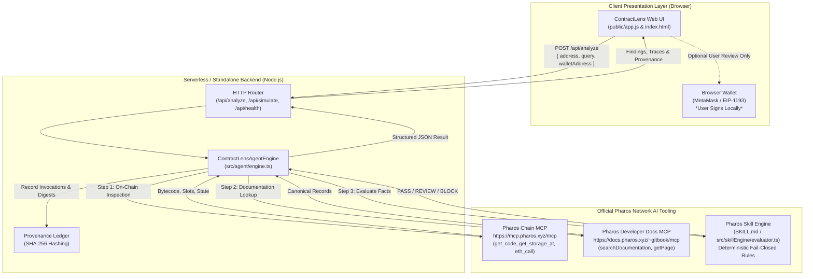

# Pharos ContractLens

[-00e5a3.svg)](https://pharosscan.xyz)
[](https://pharos-contractlens.vercel.app)
[](LICENSE)
[](#g-safety-trust--non-custodial-model)

> **Autonomous Smart Contract Due-Diligence and Interaction-Safety Agent for Pharos Pacific Mainnet**<br>
> Verifies on-chain bytecode, resolves EIP-1967 proxy implementations, checks privileged roles, cross-references official protocol documentation, and validates transactions before you sign.

---

## Table of Contents

- [A. Project Introduction](#a-project-introduction)
- [B. Quick Start — Use the Live Application](#b-quick-start--use-the-live-application)
- [C. Understanding Analysis Results](#c-understanding-analysis-results)
- [D. Main Capabilities](#d-main-capabilities)
- [E. System Architecture](#e-system-architecture)
- [F. Network & Official Pharos AI Integrations](#f-network--official-pharos-ai-integrations)
- [G. Safety, Trust & Non-Custodial Model](#g-safety-trust--non-custodial-model)
- [H. Running Locally](#h-running-locally)
- [I. API & Developer Reference](#i-api--developer-reference)
- [J. Testing & Verification Suite](#j-testing--verification-suite)
- [K. Example Investigations](#k-example-investigations)
- [L. Limitations & Responsible Use](#l-limitations--responsible-use)
- [M. Repository Structure](#m-repository-structure)
- [N. Production Deployment](#n-production-deployment)
- [O. Contributing & License](#o-contributing--license)
- [P. Important Links](#p-important-links)

---

## A. Project Introduction

### Overview
Interacting with unfamiliar smart contracts on high-speed EVM blockchains poses severe financial and operational risks:
- Hidden proxy upgradeability patterns allow administrators to swap execution logic without notice.
- Centralized minting privileges and unrenounced owner trapdoors can drain liquidity.
- Active emergency pause states silently freeze funds upon deposit.
- Malicious phishing EOAs or uninitialized addresses masquerade as verified protocol targets.
- Unconstrained AI assistants hallucinate contract security based on marketing text rather than verified on-chain state.

**Pharos ContractLens** is an evidence-first, agent-native contract review system designed specifically for the **Pharos Pacific Mainnet**. Rather than asking an ungrounded language model for an opinion, ContractLens coordinates the official **Pharos Chain MCP**, the **Pharos Developer Docs MCP**, and the **Pharos Skill Engine** to inspect raw contract bytecode, resolve storage slots, query live contract state, cross-reference official GitBook documentation, and evaluate deterministic safety policies.

### Who Should Use ContractLens
- **DeFi Traders & Users:** Review unfamiliar tokens, staking contracts, or decentralized exchange pools before approving allowances or depositing capital.
- **Protocol Integrators & Developers:** Verify that deployed dependencies, multicall routers, and oracle adapters on Pharos Pacific Mainnet match canonical addresses and possess uncompromised implementations.
- **Security Reviewers & Analysts:** Rapidly extract EIP-1967 proxy implementations, inspect privileged administrator roles, check circuit-breaker states, and audit cryptographic provenance traces.

### The Evidence-First Philosophy
ContractLens enforces a strict separation between **empirical observation** and **deterministic evaluation**:
1. **Factual Evidence Gathering:** Every observation (bytecode length, storage slots, contract call return values, documentation excerpts) is collected through read-only Model Context Protocol (MCP) tool calls.
2. **Cryptographic Provenance:** Every tool invocation, parameter set, and response payload is recorded in a tamper-evident audit ledger with SHA-256 integrity hashes.
3. **Fail-Closed Rule Engine:** Decisions are generated by a deterministic policy evaluator adhering to the Pharos Skill Engine specification. Missing or ambiguous evidence is never treated as proof of safety.

> [!IMPORTANT]
> **Due Diligence Disclaimer:** ContractLens is an automated interaction-safety and due-diligence assistant. It evaluates visible on-chain state, known storage slots, and protocol documentation. It is **not** a formal mathematical verification tool and is **not** a replacement for a comprehensive manual security audit by professional auditing firms.

---

## B. Quick Start — Use the Live Application

You can use the fully deployed web application directly in your browser without installing any software or connecting a wallet.

**Live Application URL:** [https://pharos-contractlens.vercel.app/](https://pharos-contractlens.vercel.app/)<br>
**Public Repository:** [https://github.com/JimmyOgb/pharos-contractlens](https://github.com/JimmyOgb/pharos-contractlens)

### Step-by-Step Walkthrough

```
  1. Open App          2. Select Preset Target          3. Submit Analysis            4. Review Findings
+---------------+     +---------------------------+     +-----------------------+     +------------------------+
| https://      |     | [ MultiCall3            ] |     | Click:                |     | Decision: [ PASS ]     |
| pharos-       | --> | [ Faroo Liquid Staking  ] | --> | [ Run Autonomous      | --> | Tabs:                  |
| contractlens. |     | [ Permit2               ] |     |   Due-Diligence     ] |     | - Policy Findings      |
| vercel.app    |     | [ FaroSwap Pool         ] |     +-----------------------+     | - Tool Traces          |
+---------------+     +---------------------------+                                   | - Provenance Registry  |
                                                                                      | - Unsigned Tx Review   |
                                                                                      +------------------------+
```

#### 1. Open the Dashboard
Navigate to [https://pharos-contractlens.vercel.app/](https://pharos-contractlens.vercel.app/). You will be greeted by the dark institutional dashboard displaying live system status badges:
- `Pharos Pacific Mainnet (1672)`
- `Chain MCP Online` (`https://mcp.pharos.xyz/mcp`)
- `Docs MCP Connected` (`https://docs.pharos.xyz/~gitbook/mcp`)
- `Zero Custody / Non-Custodial`

#### 2. Enter or Select a Contract Target
In the **Contract Address on Pharos (Pacific Mainnet)** input field (`#inputAddress`), enter any valid `0x`-prefixed 20-byte address, or click one of the pre-loaded live mainnet presets:
- **MultiCall3:** `0xcA11bde05977b3631167028862bE2a173976CA11` *(Canonical Batch Infrastructure)*
- **Faroo Liquid Staking:** `0x6b0A44c64190279f7034b77c13a566E914FE5Ec4` *(EIP-1967 Upgradeable Proxy)*
- **Permit2:** `0x000000000022D473030F116dDEE9F6B43aC78BA3` *(Canonical Signature Approval Router)*
- **FaroSwap Pool:** `0x41460c5E3f7cf657ea4d6a666eA4d2C38d9A5623` *(Uniswap V3 Concentrated Liquidity)*
- **Uninitialized EOA Target:** `0x000000000000000000000000000000000000dead` *(Non-contract / Zero Bytecode)*

#### 3. Enter a Query or Select a Quick Prompt
In the **Natural Language Question or Intent** field (`#inputQuery`), type your specific inquiry or click one of the quick suggestion chips:
- `Canonical Match?`
- `Proxy / Upgradeable?`
- `Privileged Roles?`
- `Emergency Paused?`

#### 4. Run Due Diligence
Click the **Run Autonomous Due-Diligence** button (`#btnAnalyze`). The agent will immediately execute its multi-tool investigation:
1. Queries the **Pharos Chain MCP** to fetch live network metadata (`get_chain_info`), latest block height (`get_block_number`), and deployed runtime bytecode (`get_code`).
2. Reads EIP-1967 storage slots (`get_storage_at`) for logic implementation (`0x360894a1...`) and beacon contracts (`0xa3f0ad74...`).
3. Executes read-only contract calls (`eth_call`) to introspect privileged ownership (`owner()`, `admin()`) and emergency state (`paused()`).
4. Queries the **Pharos Developer Docs MCP** (`searchDocumentation`) to cross-reference canonical deployments and protocol specifications.
5. Passes all normalized observations to the **Pharos Skill Engine** policy evaluator to generate a deterministic decision state (`PASS`, `REVIEW`, or `BLOCK`).

#### 5. Inspect Results Across the Four Inspection Tabs
Once analysis completes, the top banner displays the overall decision (`PASS`, `REVIEW`, or `BLOCK`) alongside a natural-language agent summary and contract metadata card. Explore the details using the four interactive tabs:
- **Policy Checks & Findings (`#tabFindings`):** Displays granular checks (Bytecode Verification, Proxy Mutability, Privileged Roles, Emergency State, Canonical Match) with severity tags (`CRITICAL`, `WARNING`, `INFO`).
- **Agent Tool Traces (`#tabTraces`):** Shows exact chronological tool invocations across the Chain MCP, Docs MCP, and Skill Engine with tool names, input arguments, and response payloads.
- **Cryptographic Provenance (`#tabProvenance`):** Displays the audit ledger where every tool execution is stamped with a deterministic SHA-256 integrity hash, target address, and timestamp.
- **Unsigned Tx Review (`#tabTx`):** If an interaction was evaluated, inspects the simulated calldata, target address, value, and simulated gas limits (`estimate_gas`). If a browser wallet is connected, the **Send Unsigned Tx to Wallet for Review** button (`#btnSendToWallet`) allows forwarding the unsigned transaction to MetaMask/browser wallet for inspection without automated signing.

---

## C. Understanding Analysis Results

ContractLens classifies every contract target into one of three unambiguous, deterministic decision states:

```
+---------------------------------------------------------------------------------+
|                                DECISION STATES                                  |
+--------------------+-----------------------------------+------------------------+
|       PASS         |              REVIEW               |         BLOCK          |
|  Verified target,  |      Valid & operational, but     |   Critical hazard or   |
| unpaused, canonical|  contains proxy upgradeability,   | missing bytecode (EOA) |
|   infrastructure   | centralized admin, or missing docs| prevents safe interaction |
+--------------------+-----------------------------------+------------------------+
```

### 1. `PASS`
- **Definition:** All evaluated checks succeeded. The target address contains deployed runtime bytecode, is not in an active emergency pause state, matches canonical protocol documentation (or standard immutable logic), and reveals no destructive trapdoors under current checks.
- **What PASS Guarantees:** The contract is active on Pharos Pacific Mainnet, standard read calls execute without reversion, and no immediate red flags were detected by the deterministic policy rules.
- **What PASS Does NOT Guarantee:** A `PASS` does **not** certify that a contract is free of logic bugs, economic attack vectors, flash-loan vulnerabilities, or reentrancy flaws.

### 2. `REVIEW`
- **Definition:** The contract is operational and structurally valid, but exhibits properties requiring human judgment before interaction.
- **Common Triggers:**
  - **Proxy Upgradeability:** The contract is an EIP-1967 proxy with a mutable logic implementation. The contract behavior can be altered by its administrative owner at any time.
  - **Centralized Admin / Owner:** An active administrative address was identified (`owner()` or `admin()`) that holds privileged control.
  - **Unverified Documentation:** The contract address is not listed in canonical developer documentation.
- **Required Action:** The user must review who holds administrative keys (multisig vs single EOA), whether timelocks exist, and whether the upgradeability is acceptable for their use case.

### 3. `BLOCK`
- **Definition:** A hard policy violation or critical risk condition was established that makes safe interaction impossible.
- **Common Triggers:**
  - **Empty Bytecode (`0x`):** The target address has zero runtime bytecode. It is an uninitialized address or an externally owned account (EOA). Sending funds to it expecting contract execution will result in loss of funds.
  - **Active Emergency Pause:** The contract has an active pause mechanism (`paused() == true`). Transactions sent to paused contracts will revert or lock tokens.
  - **Introspection Reversion:** Mandatory safety introspection reverted or the contract target threw unhandled execution faults.
- **Required Action:** Do not interact with the contract. Verify whether the address was mistyped or represents a phishing attempt.

> [!WARNING]
> **Core Policy Principles:**
> - Missing evidence is **never** treated as proof of safety.
> - An upgradeable contract is **not** automatically malicious, but it cannot be classified as `PASS`.
> - Deterministic policy evaluation always overrides heuristic or ungrounded agent speculation.

---

## D. Main Capabilities

| Capability | Status | Implementation Details |
|---|:---:|---|
| **Pharos Mainnet Chain Introspection** | **Implemented** | Connects to Pharos Pacific Mainnet (`Chain ID 1672`) via Pharos Chain MCP and JSON-RPC. |
| **Runtime Bytecode Verification** | **Implemented** | Queries `get_code`, verifies runtime length, flags zero-length non-contract addresses. |
| **EIP-1967 Proxy Resolution** | **Implemented** | Introspects implementation slot `0x360894a13ba1a3210667c828492db98dca3e2076cc3735a920a3ca505d382bbc` and beacon slot `0xa3f0ad74...`. |
| **Privileged Role & Owner Audit** | **Implemented** | Inspects `owner()` (`0x8da5cb5b`) and `admin()` (`0xf851a440`) access control selectors. |
| **Emergency Pause Detection** | **Implemented** | Queries standard circuit-breaker selector `paused()` (`0x5c975abb`). |
| **Official Documentation Retrieval** | **Implemented** | Live querying of Pharos GitBook Documentation MCP (`searchDocumentation`, `getPage`). |
| **Cryptographic Provenance Ledger** | **Implemented** | Computes SHA-256 integrity digests over all tool calls, inputs, and outputs. |
| **Read-Only Gas Simulation** | **Implemented** | Executes `eth_call` and `estimate_gas` simulation prior to any transaction review. |
| **Non-Custodial Wallet Handoff** | **Implemented** | Connects to browser wallets (MetaMask/EIP-1193) strictly for user-governed manual signing. |
| **Automated Mempool Broadcasting** | **Permanently Blocked** | By design, agent has zero signing capability and zero broadcast authority. |
| **Symbolic Execution / Formal Proofs** | *Planned* | Deep formal verification of bytecode bytecode opcode paths is slated for future releases. |

---

## E. System Architecture

ContractLens is built with an asynchronous TypeScript core that cleanly decouples tool data ingestion, policy evaluation, cryptographic provenance tracking, and client presentation.



### Architectural Workflow
1. **User Request Initiation:** The client sends a request containing the contract address, optional natural-language query, and optional user wallet address.
2. **Chain MCP Introspection:** The agent queries `get_chain_info` to ensure mainnet alignment, `get_block_number` for time anchoring, `get_code` to retrieve runtime bytecode, and `get_storage_at` for proxy slots.
3. **State Introspection:** Read-only `eth_call` invocations inspect privileged roles (`owner()`, `admin()`) and emergency state (`paused()`).
4. **Docs MCP Cross-Referencing:** The agent searches canonical documentation for deployment confirmations and protocol specifications.
5. **Skill Engine Deterministic Evaluation:** The evaluator scores the factual inputs against explicit security policies and outputs `PASS`, `REVIEW`, or `BLOCK`.
6. **Provenance Sealing:** Every observation and tool trace is cryptographically hashed with SHA-256 and sealed into the response.
7. **Client Rendering & Unsigned Tx Review:** The UI displays findings, traces, and an unsigned transaction preview that can be reviewed in the user's browser wallet.

---

## F. Network & Official Pharos AI Integrations

### Network Configuration
- **Network Name:** Pharos Pacific Mainnet
- **Chain ID:** `1672`
- **RPC URL:** `https://rpc.pharos.xyz`
- **Block Explorer:** `https://pharosscan.xyz`
- **Currency:** Pharos Native Token (PR)

---

### Integration 1: Pharos Chain MCP
- **Endpoint:** `https://mcp.pharos.xyz/mcp`
- **Protocol:** MCP Specification `2024-11-05` over HTTP SSE
- **Access Pattern:** Read-only JSON-RPC queries
- **Tools Utilized:**
  - `get_chain_info`: Validates active chain is Pharos Pacific Mainnet (`1672`).
  - `get_block_number`: Retrieves the authoritative block height at time of analysis.
  - `get_code`: Fetches deployed contract runtime bytecode.
  - `get_storage_at`: Reads EIP-1967 storage slots (`0x360894a1...` for implementation, `0xa3f0ad74...` for beacon).
  - `call`: Introspects standard ERC/EIP view functions (`owner()`, `paused()`, `name()`).
  - `estimate_gas`: Simulates transaction gas consumption in a sandbox without mempool broadcast.
- **Fail-Safe Behavior:** If the Chain MCP endpoint experiences intermittent latency, the agent utilizes a direct JSON-RPC client fallback against `https://rpc.pharos.xyz` to ensure unbroken due diligence.

---

### Integration 2: Pharos Developer Docs MCP
- **Endpoint:** `https://docs.pharos.xyz/~gitbook/mcp` (Official GitBook MCP endpoint)
- **Protocol:** MCP Specification `2024-11-05`
- **Tools Utilized:**
  - `searchDocumentation`: Queries official Pharos developer documentation for canonical contract deployments, bridge endpoints, and core contract addresses.
  - `getPage`: Retrieves full documentation pages for in-depth protocol requirement verification.
- **Graceful Fallback:** If the external docs endpoint is unreachable or throttled, the agent falls back to an embedded cache of canonical Pharos infrastructure addresses (MultiCall3, FaroSwap, Permit2) and explicitly notes the fallback provenance in the tool trace.

---

### Integration 3: Pharos Skill Engine
- **Specification:** Complies with the official [Pharos Skill Engine standard](https://github.com/PharosNetwork/pharos-skill-engine) (`SKILL.md`).
- **Policy Evaluator:** Implemented in `src/skillEngine/evaluator.ts`.
- **Policy Invariants:**
  1. *Bytecode Existence:* Bytecode length `== 0` or `"0x"` triggers an unconditional `BLOCK`.
  2. *Emergency Circuit-Breakers:* `paused() == true` triggers an unconditional `BLOCK`.
  3. *Proxy Mutability:* Detected EIP-1967 implementation slot containing a nonzero address triggers `REVIEW`.
  4. *Privileged Admin Presence:* Nonzero owner/admin addresses trigger `REVIEW` to mandate multisig/timelock inspection.
  5. *Canonical Protocol Verification:* Validated canonical deployments without proxy trapdoors receive `PASS`.

---

## G. Safety, Trust & Non-Custodial Model

ContractLens is architected with strict, uncompromised security boundaries:

```
+-----------------------------------------------------------------------------------+
|                        CONTRACTLENS ZERO-TRUST BOUNDARIES                         |
+-----------------------------------------------------------------------------------+
| [x] ZERO PRIVATE KEYS       No private keys or mnemonic phrases stored or accepted|
| [x] STRICTLY READ-ONLY      No mempool transaction broadcasting capability        |
| [x] USER-OWNED SIGNING      Unsigned transactions reviewed locally in user wallet |
| [x] DETERMINISTIC POLICY    Rules enforced by code, not unconstrained LLM output  |
| [x] PROVENANCE AUDITING     SHA-256 hashes generated for every tool input & output|
| [x] PROMPT INJECTION SHIELD External queries sanitized; cannot override policies  |
+-----------------------------------------------------------------------------------+
```

1. **Non-Custodial Architecture:** The application does not accept, store, transmit, or request private keys, seed phrases, or custody credentials.
2. **Read-Only Invariant:** Write methods (e.g., `eth_sendRawTransaction`) are excluded from server capabilities.
3. **User Signing Ownership:** When an unsigned transaction is simulated or inspected, it is passed to the user's browser wallet via standard EIP-1193 (`eth_sendTransaction`). The user retains 100% signing authority.
4. **Prompt Injection Hardening:** Natural-language inputs and retrieved documentation strings are treated strictly as untrusted parameters, never as executable agent instructions.
5. **Cryptographic Provenance:** Every tool interaction records input and output SHA-256 hashes, creating an auditable evidence chain.

---

## H. Running Locally

### Prerequisites
- **Node.js:** Node.js 20.0.0 or higher (Tested on Node.js v22 and v24)
- **Package Manager:** npm 10 or higher
- **Git**

### Installation Steps

```bash
# 1. Clone the public repository
git clone https://github.com/JimmyOgb/pharos-contractlens.git
cd pharos-contractlens

# 2. Install dependencies
npm install

# 3. Configure environment variables (optional, defaults provided)
cp .env.example .env

# 4. Build production bundles
npm run build

# 5. Start the local server
npm run serve
```

Open your browser and navigate to:
```
http://localhost:3000
```

### Environment Configuration (`.env`)
```ini
# Pharos Pacific Mainnet Configuration
PHAROS_CHAIN_ID=1672
PHAROS_RPC_URL=https://rpc.pharos.xyz
PHAROS_CHAIN_MCP_URL=https://mcp.pharos.xyz/mcp
PHAROS_DOCS_MCP_URL=https://docs.pharos.xyz/~gitbook/mcp

# Local Server Port
PORT=3000
```

---

## I. API & Developer Reference

ContractLens provides clean REST API endpoints for automated contract due diligence.

### 1. `GET /api/health`
Checks service health and returns network metadata.

**Response (200 OK):**
```json
{
  "status": "ok",
  "product": "Pharos ContractLens",
  "version": "1.0.0",
  "network": "Pharos Pacific Mainnet",
  "chainId": 1672,
  "rpcUrl": "https://rpc.pharos.xyz",
  "chainMcpEndpoint": "https://mcp.pharos.xyz/mcp",
  "docsMcpEndpoint": "https://docs.pharos.xyz/~gitbook/mcp",
  "mode": "Strictly Read-Only Agent (Non-Custodial)",
  "timestamp": "2026-11-07T16:00:00.000Z"
}
```

---

### 2. `POST /api/analyze`
Executes full multi-tool contract analysis.

**Request Body:**
```json
{
  "address": "0xcA11bde05977b3631167028862bE2a173976CA11",
  "query": "Is this contract canonical and safe to interact with?",
  "walletAddress": "0x1234567890123456789012345678901234567890"
}
```

**Response (200 OK):**
```json
{
  "contractAddress": "0xcA11bde05977b3631167028862bE2a173976CA11",
  "decision": "PASS",
  "agentSummary": "Contract 0xcA11...CA11 has been successfully verified on Pharos Pacific Mainnet...",
  "checks": [
    {
      "id": "BYTECODE_EXISTS",
      "name": "Deployed Bytecode Verification",
      "status": "PASS",
      "severity": "CRITICAL",
      "evidence": "Runtime bytecode verified (3,248 bytes)."
    },
    {
      "id": "PROXY_MUTABILITY",
      "name": "Proxy Implementation Analysis",
      "status": "PASS",
      "severity": "WARNING",
      "evidence": "No EIP-1967 proxy implementation detected; contract logic is immutable."
    }
  ],
  "toolTraces": [
    {
      "toolName": "get_code",
      "category": "chain",
      "input": { "address": "0xcA11bde05977b3631167028862bE2a173976CA11" },
      "output": { "bytecodeSize": 3248 },
      "durationMs": 142
    }
  ],
  "provenanceRegistry": [
    {
      "toolName": "get_code",
      "sha256": "4b92b6a21...f3a9",
      "timestamp": "2026-11-07T16:00:00.142Z"
    }
  ]
}
```

---

### 3. `POST /api/simulate`
Simulates a read-only call or estimates gas consumption without submitting a transaction.

**Request Body:**
```json
{
  "to": "0xcA11bde05977b3631167028862bE2a173976CA11",
  "data": "0x",
  "from": "0x0000000000000000000000000000000000000001",
  "value": "0"
}
```

**Response (200 OK):**
```json
{
  "success": true,
  "callResult": "0x",
  "gasEstimated": "21000",
  "timestamp": "2026-11-07T16:00:00.000Z"
}
```

---

### 4. `GET /api/docs?q=multicall`
Direct search against the Pharos Developer Documentation tool.

---

### 5. `GET /api/tools`
Lists all available official Pharos AI tool integrations, schemas, and operational statuses.

---

## J. Testing & Verification Suite

ContractLens includes both deterministic offline unit tests and live on-chain integration tests against Pharos Pacific Mainnet.

### Run Unit Tests (Deterministic & Offline)
Verifies address sanitization, deterministic decision matrices, prompt injection defenses, provenance generation, and transaction safety invariants:
```bash
npm run test:unit
```
*Result: 12 tests passing (0 failures).*

### Run Live On-Chain Integration Tests
Executes live network requests against `https://mcp.pharos.xyz/mcp`, `https://docs.pharos.xyz/~gitbook/mcp`, and live contracts on Pharos Pacific Mainnet (`1672`):
```bash
npm run test:integration
```
*Result: 7 tests passing (0 failures).*

### Run Full Test Suite
```bash
npm test
```

---

## K. Example Investigations

### Case 1: MultiCall3 (`PASS`)
- **Target Address:** `0xcA11bde05977b3631167028862bE2a173976CA11`
- **Bytecode Inspection:** Deployed runtime bytecode found (3,248 bytes).
- **Proxy Analysis:** EIP-1967 implementation slot is zero. Logic is immutable.
- **State Introspection:** Not paused. No single-owner administrative backdoors.
- **Documentation:** Matches canonical MultiCall3 deployment in Pharos developer documentation.
- **Decision:** **`PASS`**

---

### Case 2: Faroo Liquid Staking (`REVIEW`)
- **Target Address:** `0x6b0A44c64190279f7034b77c13a566E914FE5Ec4`
- **Bytecode Inspection:** Deployed runtime bytecode found (375 bytes).
- **Proxy Analysis:** EIP-1967 implementation slot `0x360894a1...` resolves to active logic contract `0xfd5952B94F3b9876C12Ec24E54F300ea9039708d`.
- **State Introspection:** Contract is unpaused. Privileged administrator address identified (`0xc30db0089a8c1f93f5451ec9539fc4fd70a5805b`).
- **Documentation:** Identified as Faroo liquid staking infrastructure.
- **Decision:** **`REVIEW`** *(Flagged for proxy upgradeability and administrative control).*

---

### Case 3: Uninitialized Target / Dead EOA (`BLOCK`)
- **Target Address:** `0x000000000000000000000000000000000000dead`
- **Bytecode Inspection:** Bytecode returned is empty (`0x`). Zero deployed runtime instructions.
- **Proxy Analysis:** Not applicable (no storage).
- **State Introspection:** Introspection calls fail or yield empty state.
- **Documentation:** Target is not a verified contract.
- **Decision:** **`BLOCK`** *(Unconditional block: sending contract calls or approvals to zero-bytecode targets will cause permanent loss of funds).*

---

## L. Limitations & Responsible Use

- **Not a Security Audit:** ContractLens automates due diligence based on observable on-chain state, known EIP standards, and available documentation. It does not replace a comprehensive, manual code audit by professional security researchers.
- **Heuristic Scope:** The agent detects known standard proxy patterns (EIP-1967, Beacon) and common access control selectors (`owner()`, `admin()`). Non-standard custom proxy implementations or obfuscated storage layouts may require deeper manual decompiler analysis.
- **Network Dependency:** Accuracy relies on the availability of the Pharos Pacific Mainnet RPC and official MCP endpoints. In the event of network disruption, fail-closed principles prevent assuming unverified targets are safe.

---

## M. Repository Structure

```
pharos-contractlens/
├── api/                     # Vercel serverless function entry points
│   ├── analyze.js           # Full contract analysis endpoint
│   ├── docs.js              # Documentation search endpoint
│   ├── health.js            # Service health & network metadata
│   ├── simulate.js          # Read-only simulation & gas estimation
│   └── tools.js             # AI tool registry & schema endpoint
├── docs/                    # Technical specifications & reports
│   ├── ACCEPTANCE_REPORT.md # Verification report & test outputs
│   ├── AGENT_WORKFLOW.md    # Multi-tool execution loop specification
│   ├── ARCHITECTURE.md      # Detailed system architecture document
│   ├── DEMO_SCRIPT.md       # Video demonstration storyboard
│   ├── SECURITY.md          # Security invariants & threat model
│   └── TOOL_INTEGRATIONS.md # Pharos MCP & Skill Engine audit
├── public/                  # Responsive dark web interface
│   ├── app.js               # Client controller & wallet handoff
│   ├── index.html           # Dashboard interface & inspection tabs
│   └── styles.css           # Institutional theme styling
├── scripts/
│   └── build.js             # Production bundler (esbuild)
├── src/                     # TypeScript core source code
│   ├── agent/               # Autonomous agent orchestration loop
│   ├── api/                 # Serverless API handlers
│   ├── config/              # Network endpoints & selector constants
│   ├── mcp/                 # Pharos Chain MCP & Docs MCP clients
│   ├── server/              # Standalone HTTP router & local server
│   ├── skillEngine/         # Deterministic policy rules evaluator
│   └── types/               # Strict TypeScript schemas & interfaces
├── tests/
│   ├── integration/         # Live tests against Pharos Pacific Mainnet
│   └── unit/                # Deterministic offline test suite
├── .env.example             # Example environment variables
├── .gitignore
├── LICENSE                  # MIT License
├── package.json             # Package manifests and scripts
├── README.md                # Project documentation
├── SKILL.md                 # Pharos Skill Engine specification
├── tsconfig.json            # Strict TypeScript configuration
└── vercel.json              # Vercel deployment configuration
```

---

## N. Production Deployment

ContractLens is deployed as a high-availability, zero-maintenance serverless application on Vercel.

- **Production URL:** [https://pharos-contractlens.vercel.app/](https://pharos-contractlens.vercel.app/)
- **Configuration:** Configured via [`vercel.json`](file:///vercel.json) with standalone serverless function routes in `/api`.
- **Edge Assets:** Static frontend assets are served globally via Vercel Edge Network from `/public`.
- **Zero Cost & Non-Custodial:** Runs without paid API dependencies or custody secrets in production.

---

## O. Contributing & License

Contributions to Pharos ContractLens are welcome! Please ensure all pull requests:
1. Maintain strict TypeScript type-checking (`npm run typecheck`).
2. Pass all unit and integration tests (`npm test`).
3. Adhere to non-custodial and fail-closed security invariants.

This project is licensed under the **MIT License**. See the [LICENSE](LICENSE) file for details.<br>
Copyright (c) 2026 JimmyOgb.

---

## P. Important Links

- **Live Application:** [https://pharos-contractlens.vercel.app/](https://pharos-contractlens.vercel.app/)
- **GitHub Repository:** [https://github.com/JimmyOgb/pharos-contractlens](https://github.com/JimmyOgb/pharos-contractlens)
- **Pharos Pacific Mainnet Explorer:** [https://pharosscan.xyz](https://pharosscan.xyz)
- **Pharos Pacific RPC:** `https://rpc.pharos.xyz`
- **Pharos Chain MCP Endpoint:** `https://mcp.pharos.xyz/mcp`
- **Pharos Developer Documentation:** [https://docs.pharos.xyz](https://docs.pharos.xyz)
- **Pharos Skill Engine Repository:** [https://github.com/PharosNetwork/pharos-skill-engine](https://github.com/PharosNetwork/pharos-skill-engine)
